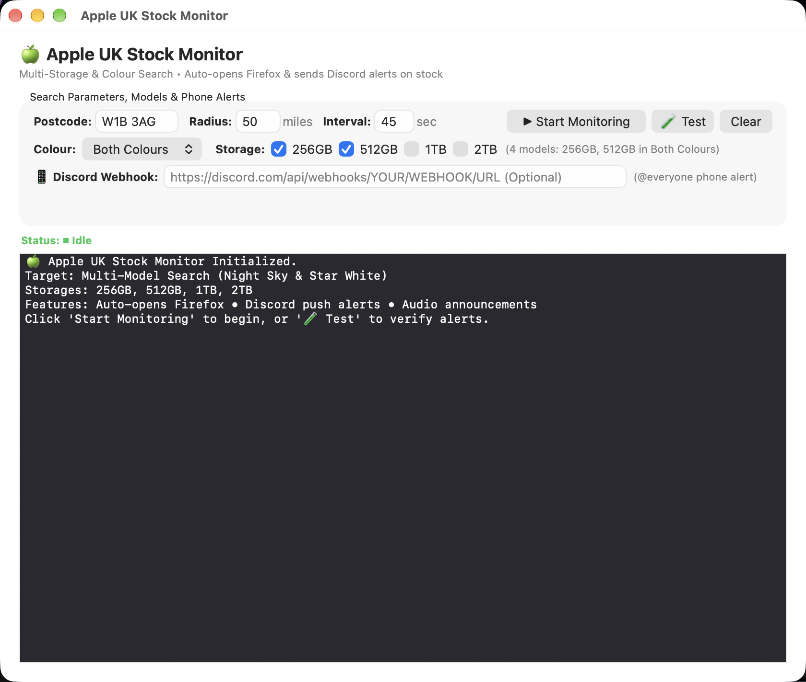

# 🍏 Apple UK Stock Monitor

> **Real-time, multi-model inventory tracking for Apple Retail Stores across the UK.**  
> Automatically monitors pickup stock, launches your browser straight to checkout, sounds audio alerts, and delivers high-priority Discord push notifications directly to your phone.



---

## ✨ Features

- **⚡ High-Speed Multi-Model Scanning:**
  Query multiple colours (*Night Sky*, *Star White*) and multiple storages (*256GB*, *512GB*, *1TB*, *2TB*) simultaneously in a **single HTTP/2 request** with zero extra latency or Akamai bot-challenge risk.
- **📱 Instant Discord Phone Notifications:**
  - **Stock Drops:** Pings `@everyone` with loud sound, vibration, and a direct `[🛒 BUY NOW ON APPLE STORE]` link.
  - **Hourly Status Reports:** Automatically sends a structured `@everyone` overview every 60 minutes showing active uptime, stores scanned, and total check count.
  - **Quiet Status Logs:** Logs startup, pause, network warnings, and rate-limit cooldowns quietly without pinging your phone.
- **🚀 Instant Browser Auto-Launch:**
  When stock is detected, immediately pops open **Firefox** directly to the product's checkout page for fastest possible checkout.
- **🔊 Voice Announcements & Audio Alerts:**
  Speaks the in-stock store location aloud using macOS Text-to-Speech (`say`) alongside native system alert chimes.
- **☕ Built-in System Sleep Prevention:**
  Leverages Apple's native `ProcessInfo.beginActivity` power assertion so your Mac can stay in screensaver or lock screen without cutting Wi-Fi or pausing checks.
- **📐 Fluid & Responsive Native macOS UI:**
  Built 100% natively in **Swift AppKit / Cocoa** (no Electron, no web wrappers). Resizes smoothly with fluid Auto Layout.

---

## 🚀 Quick Start

### Option 1: Native macOS App (Recommended)

1. **Clone the repository:**
   ```bash
   git clone https://github.com/fotcss/apple-stock-checker.git
   cd apple-stock-checker
   ```

2. **Build the native `.app` bundle:**
   ```bash
   ./build.sh
   ```
   *This compiles the Swift AppKit binary and packages a self-contained `Apple Stock Monitor.app` onto your Desktop.*

3. **Launch the application:**
   Double-click `Apple Stock Monitor.app` on your Desktop, select your models, enter your postcode, and click **▶ Start Monitoring**.

---

### Option 2: Command Line (CLI)

You can also run the monitor directly in your terminal:

```bash
# Monitor all colours for 256GB & 512GB near your postcode
python3 check_stock.py --postcode W1B 3AG --distance 50 --color both --storages 256GB 512GB
```

#### CLI Options:
| Flag | Default | Description |
| :--- | :---: | :--- |
| `--postcode` | `W1B 3AG` | UK Postcode to search around |
| `--distance` | `50` | Maximum radius in miles |
| `--color` | `both` | Colour filter: `both`, `night-sky`, or `star-white` |
| `--storages` | `256GB` | Storages to check: `256GB`, `512GB`, `1TB`, `2TB` |
| `--interval` | `45` | Check cadence in seconds |
| `--discord` | `""` | Discord Webhook URL for instant phone push alerts |
| `--test-browser`| `false` | Tests browser launch, voice chime, and Discord ping |
| `--keep-monitoring`| `false` | Continue scanning after stock is detected |

---

## 📱 Setting Up Discord Phone Alerts (30 Seconds)

1. In Discord on your Mac or phone, go to any server where you have permissions (or create a private 1-person server).
2. Go to **Channel Settings (⚙️) ➔ Integrations ➔ Webhooks ➔ New Webhook**.
3. Name it `Apple Stock Alert` and click **Copy Webhook URL**.
4. Paste the URL into the **Discord Webhook** field in the app.
5. Click **🧪 Test** to verify that your phone receives the alert!

---

## 🛠️ How It Works

1. **Akamai & Apple Anti-Bot Evasion:**  
   Uses native macOS `curl` with persistent session cookies, HTTP/2 multiplexing, realistic browser headers, and randomized request pattern jitter to avoid Akamai rate-limiting blocks (HTTP 541 / 403).
2. **Unified Variant Payload:**  
   Rather than making separate requests for each colour and storage variant, the engine batches queries into Apple's `/shop/retail/pickup-message` endpoint using `parts.0=...&parts.1=...`.
3. **AppKit Architecture:**  
   The UI is compiled with `swiftc -O` and communicates with the monitoring process asynchronously via non-blocking standard I/O pipes.

---

## 📜 License

Distributed under the **MIT License**. See [`LICENSE`](LICENSE) for more details.
